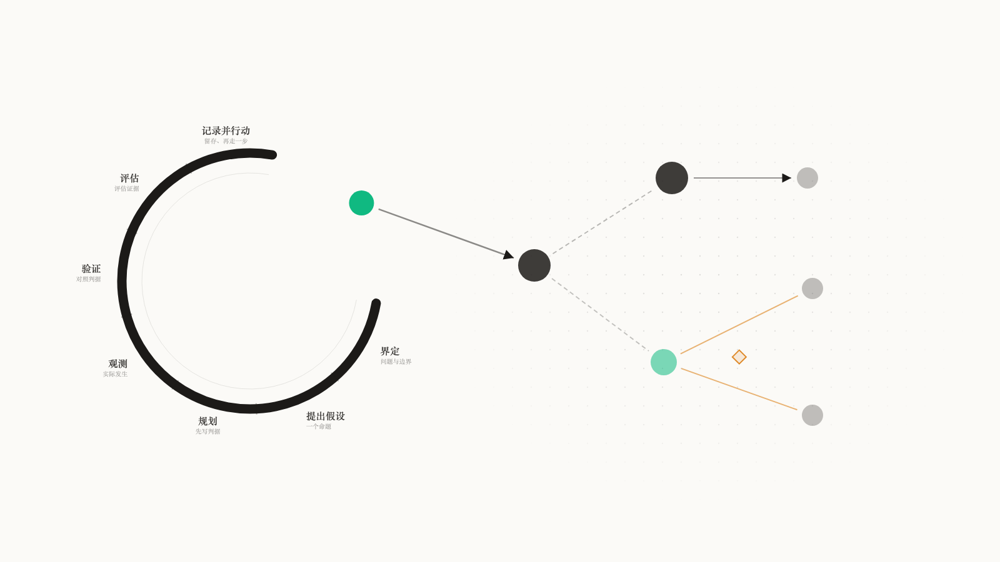
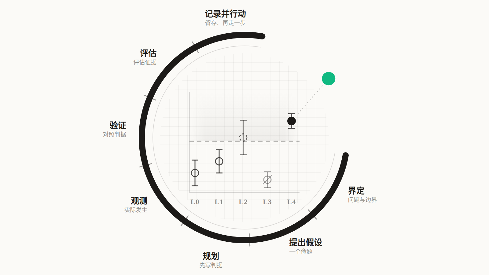
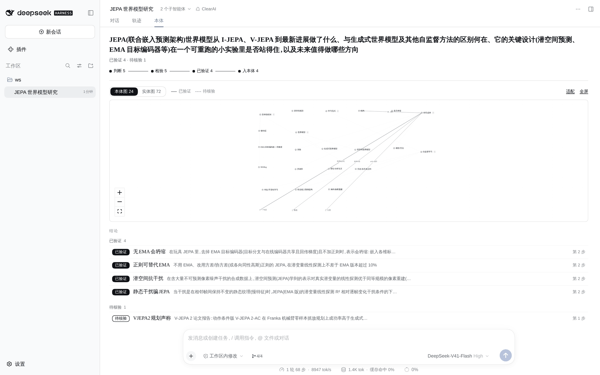
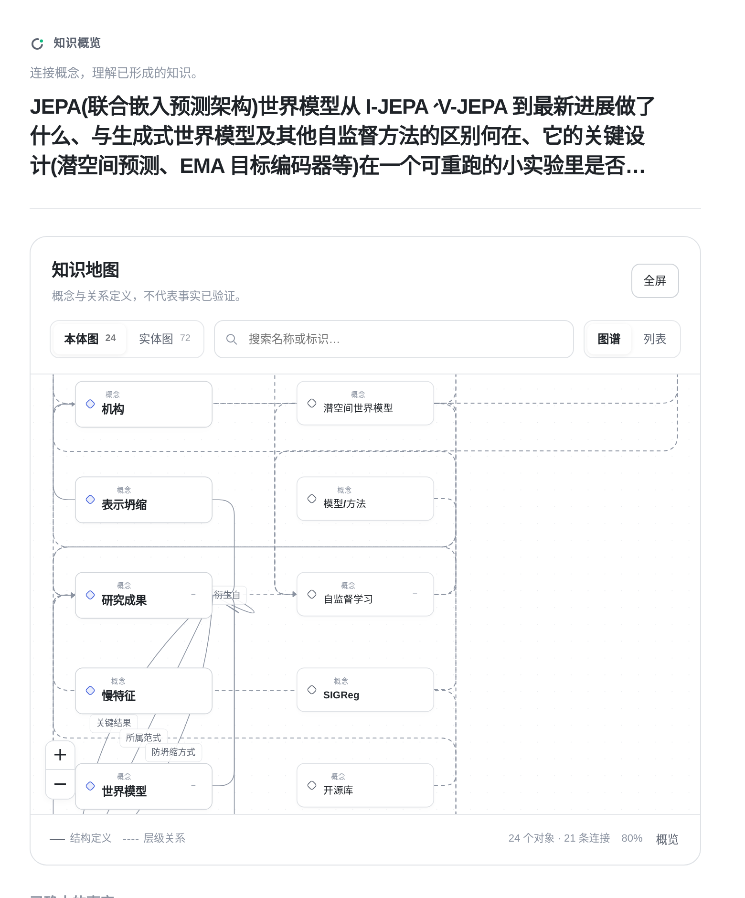
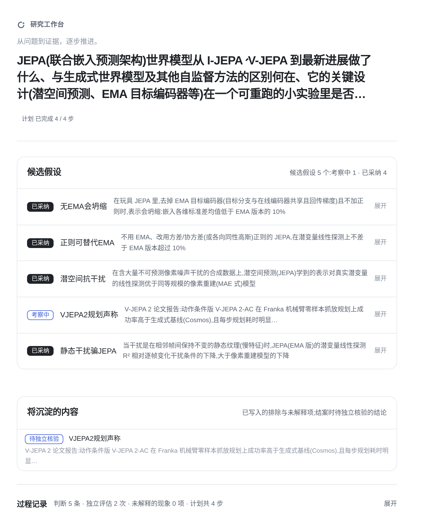

<p align="center">
  <picture>
    <source media="(prefers-color-scheme: dark)" srcset="brand/logo-lockup-dark.png">
    
  </picture>
</p>

<p align="center"><a href="README.md">English</a> · <b>中文</b></p>

<p align="center">
  <a href="https://trendshift.io/repositories/248415?utm_source=trendshift-badge&amp;utm_medium=badge&amp;utm_campaign=badge-trendshift-248415" target="_blank" rel="noopener noreferrer"></a>
</p>

**你的研究，长成一个本体。**

ClearAI 是一个**本体发现与探索平台**，核心由两个概念支撑：

- **领域本体**（你得到什么）——项目自己的词汇、经循环确立的知识条目、以及它们的图。研究结束时你拿到一个持续生长的知识结构，下一轮按概念检索。
- **认识论循环**（你怎么得到它）——问题 → 本体（相关的量如何测量、如何相互影响）→ 候选假设与各自的预测 → 一次可能失败的检验 → 证据 → 带范围的结论 → 长进本体。L3/L4 支持性裁决需要独立评估、材料引用和逐项判据结果；词汇与结构边是定义，并不代表已验证的主张。

> 结构定义与有证据支持的断言分开呈现；引用存在不等于内容真实。

> 0.5.9 使用 DSH 官方行内研究事件，研究与本体保留独立页签。[发布验收](docs/optimization/0.5.9-release/README.md)记录真实端到端任务、费用与限制。

```bash
# 安装（npm 包，预构建——无需构建步骤，不会触发 allowBuilds 授权）
dsh plugin --profile web add clearai-dsh@0.5.9
# 或在应用里：侧栏「插件」→ 添加插件 → clearai-dsh@0.5.9
```

重启 `dsh web`，在新建会话顶部的模式选择器里选 **ClearAI** 即可。这就是全部步骤。[完整安装说明 ↓](#安装与使用)


<picture>
  <source media="(prefers-color-scheme: dark)" srcset="docs/diagrams/ontology-hero-dark.zh-CN.png">
  
</picture>

*0.5.8 生产界面回放已归档的 JEPA 真实会话。图中是历史研究数据，不是本版新增模型结果；结构定义与已核验断言分开呈现。[截图来源](docs/shots/0.5.8/jepa-provenance.json)。*

---

## 你得到什么：领域本体

一个**领域本体**，它在你研究的过程中生长：

- **词汇**——你的项目用什么语言说话：概念、谓词、值形态、单位。约定本身没有对错，有对错的是用这些词写下的句子。
- **已确立条目**——通过了循环的知识：每条带边界、支持等级、证据链。每条都写明适用边界，否则无法安全引用。
- **本体图与实体图**——你的领域长什么样（结构），你已经验证出了什么（战况）。
- **冲突读数**——两条互相矛盾的结论自动亮出来；系统只报出冲突，撤回或维持由你决定。

## 你怎么得到它：认识论循环

多数 agent loop 只跟踪一件事：任务做完没有。认识论循环还跟踪**一个结论凭什么被信任**：

| | 任务循环 | 认识论循环 |
|---|---|---|
| 驱动问题 | 下一步做什么？ | 我们现在知道什么，依据是什么？ |
| 完成 | 模型宣布完成 | 系统按交付的证据算出来 |
| 裁决 | 谁做的谁说了算 | 分离——超过一定等级，做的人不能判自己 |
| 失败 | 删掉、重来、忘掉 | 留下：被推翻的命题是结果，不是噪声 |
| 停止 | 模型觉得差不多了 | 会改变答案的候选与反常都已处理，或写进「尚未确定的事项」 |
| 沉淀 | 一段聊天记录 | **一个本体**：结构定义与有依据的断言并列呈现 |

<picture>
  <source media="(prefers-color-scheme: dark)" srcset="docs/diagrams/epistemic-loop-hero-dark.zh-CN.png">
  
</picture>

*环内是这台仪器的读数面：横轴是 L0–L4 七个等级，那条虚线是**事先登记进判据**的阈值；五个观测各带误差棒——被支持的填实、无法判定的画虚圈、被推翻的留在原位打一道斜杠（什么都不删）。开口处那颗 emerald 是唯一越过判据、落定成事实的读数。*

循环里本体在前，不在后：

- **立题时写本体。** 答案涉及哪些量、各由什么测量、读数如何核对、量之间如何相互影响，随立题一次写入。缺测量方式的度量，不能立题。
- **本体给出候选。** 探索问题建议比较多个候选并注明来源关系；至少两个候选是指导原则，并非所有任务的硬门槛；每一步动手前按候选分别写预测，预测都一样的步骤会被指出无法区分它们。
- **反常要有去处。** 和预测或本体对不上的读数记成未解释项：被解释、写明理由排除，或写进结论；指向已确立事实的未解释项会让那条事实回到「待核验」。
- **结论按问题交付。** 每个问题四部分：结论 / 依据 / 尚未确定的事项 / 待您决策。仍在考察中的候选和开着的未解释项没写进结论，就不能以「达成」结案。

任务状态从会话记录派生，文件完整性凭据由宿主另外持久化；模型的工具里没有可以宣告某一步完成的字段，目标也只能在独立评估通过后完成。ClearAI 只做宿主做不了的那部分——认识论契约、领域本体、呈现；目标续跑、子代理、问人、交付卡片、文件历史都用 DSH 原生的。

ClearAI **不**声称递归自我改进。它提供的是自我改进系统所需要的认识论底座。详见[定位](docs/positioning.zh-CN.md)与[OpenRSI 调研](docs/research-openrsi.md)。

---

## 安装与使用

**要求：** DSH ≥ `0.2.2-rc.1`，这是 0.5.8 的目标宿主。评估者仅使用 `startActivation` 和独立评估者预设，不保留旧派遣 API 分支。

**推荐——在应用里装，并把版本钉住：**

侧栏打开**「插件」→ 添加插件**，填 `clearai-dsh@0.5.9`，安装。这就是 DSH 自己的插件管理器：它把你填的东西交给 pnpm，校验这个包声明了组合包、与当前宿主兼容，然后当场生效。（设置里的**插件列表**是**只读清单**；安装入口在侧栏那个「插件」页。）

**或者开终端——同一次安装：**

```bash
dsh plugin --profile web add clearai-dsh@0.5.9
```

从 npm registry 装预构建产物。本机不跑任何编译，因此不需要批准 `allowBuilds` 授权——命令返回时插件就已经可用。

> **为什么要钉版本。** pnpm ≥ 11 会**压住刚发布的版本**：`minimumReleaseAge` 默认 1440 分钟，而这条内置默认是**非严格**的，于是裸包名（或 `@latest`）会**静默回退到一天以前的最新版**——刚发完新版时，那就是**上一版**。DSH 的插件管理器把你填的 spec **原样**转给 pnpm，而且**不比对**装到的是不是你要求的，所以这次降级会显示成安装成功；它的预览卡也帮不上忙：预览走 `pnpm view`，**不受**这条策略过滤，于是可能出现「预览显示最新版、装下去是上一版」。两种写确切版本的办法：
>
> - **把版本钉住**（上面两条命令都是）——pnpm 会自己记下例外。
> - **或者一次性豁免这个包**，写在 profile 的 `pnpm-workspace.yaml` 里；之后裸包名也能装：
>
>   ```yaml
>   minimumReleaseAgeExclude:
>     - clearai-dsh
>   ```

**也提供——一条命令的安装器**（它自己解析当前版本并钉住，因此不受这条延迟影响）：

```bash
npx clearai-dsh install
```

底层是同一个安装；它会从 PATH（或经 npx）解析出 DSH CLI，装进 `web` profile，再把合成后的配置读回来验证，所以「成功」不是靠信。想走引导式流程就用它，`--lang zh|en` 可指定安装器输出语言。

**社区市场（第三方）**：[dsh-market](https://github.com/dsh-market/dsh-market) 只列 [awesome-dsh-plugin](https://github.com/awesome-dsh-plugin/awesome-dsh-plugin) 目录里的条目，并且会替你钉住版本；ClearAI 的条目正在那边评审。它不属于 DSH，也不是装本插件的必要步骤。

**从源码安装（开发用，不是常规路径）：**

```bash
dsh plugin --profile web add github:Clearailhc/clearai-dsh
```

Git 拉的是源码而不是构建产物，所以 pnpm ≥10 会拒绝运行 `prepare` 脚本，直到你在该 profile 的 `pnpm-workspace.yaml` 里加上 `allowBuilds` 条目。那条授权的含义是**允许该包代码在安装时于你机器上执行**——只在你读过源码后再授权，并且固定 commit。如果你只是想用 ClearAI，请用上面的 npm 安装。

安装侧的输出**跟系统语言走**（`--lang zh|en` 可覆盖；`doctor` 同样认这个开关）。运行时依赖只有 `zod`——图谱那套栈在构建期就打进客户端了。


装完重启 `dsh web`（`npx @deepseek-ai/dsh web`），然后**新建会话，在顶部的模式选择器里切换到 `ClearAI`**：

1. 打开 `dsh web`，点「新建会话」；
2. 点顶部当前的模式名（默认是「标准模式」），展开预设列表；
3. 选 **ClearAI**——卡片描述就一句:「利用认识论循环构建可信本体。Build a trustworthy ontology through the epistemic loop.」；
4. 像平常一样提问。普通问答照常走；一旦立了目标，系统自动进入知识模式：已知送上来，本体随立题写下，结论过证据才准入。过程在「探索」一格看，结论在「本体」一格看。只有你能做的决定才会来问你。

<picture>
  
</picture>

*[JEPA 世界模型](docs/cases/jepa-world-model.zh-CN.md)那场会话之后的「本体」一格（0.5.0 布局；0.5.1 起，进度轨与全部判断移到「探索」一格的过程记录，「本体」一格改为结论卡、图、已确立的事实与经验）。*

如果 PATH 上没有 pnpm：`npm install -g pnpm`（别用 `corepack enable`——它装的是版本转发器，可能下载一个自己启动不了的 pnpm）。

从仓库开发：

```bash
npm test                       # 17 份套件
node tools/build-package.mjs   # 由源装配 dist/
node tools/verify-package.mjs  # 现场重建并逐字节比对
node docs/diagrams/build-hero.mjs   # 重画产品主图(需 google-chrome)
```

`dist/` 是生成物，不进版本库。见 [DSH 集成](docs/dsh-integration.zh-CN.md)。

---

## 它长什么样

中栏两格：**探索**与**本体**。探索记录过程，本体只放结果。计划进度同步到 DSH 原生的 todo 停靠栏。

**探索**——当前在回答什么、还有哪些可能未被排除、下一步做什么。页眉是课题与阶段（广度调研 / 定向求解）、当前问题、计划进度；下面依次是待您处理的事项、调研板块（广度调研时）、每个问题的候选假设（考察中 / 已排除 / 已采纳 / 暂不考察，点开看提出依据、推翻条件、预测与关联记录）、下一步及各候选的预测（预测相同时说明此步骤无法区分它们）、未解释的现象。新发现的问题带「立为问题 / 暂缓」两个按钮，按下即替您向模型发一句话，由模型修订立题。最下面是默认折叠的**过程记录**：判断的计数与进度轨、全部判断、计划的步骤与门。

**本体**——先读知识地图，再看结论与依据，最后是已确立知识。结构定义与实体断言分层展示；用搜索或列表选择对象，查看邻域、完整名称和证据。图谱保留用户视口与拖动位置。

**交付**——结案时，各步收下的产物以 DSH 原生交付卡片出现；每轮改了哪些文件，看 DSH 原生的改动卡片。

**语言**——系统自己写的话（工具结果、运行态卡、问你的话、`clear/` 下的文件）都跟着你说话的语言走，中文或英文。面板跟着界面语言。

<picture>
  
</picture>

*当前本体面板：默认保持可读缩放，概览按钮可查看全图；节点不因图谱密集而被截断。数据来自有来源记录的 JEPA 历史会话。*

<picture>
  
</picture>

*研究面板：JEPA 历史会话回放。另见[深色](docs/shots/0.5.8/jepa-dark-explore.png)、[窄屏](docs/shots/0.5.8/jepa-mobile-explore.png)与[实体详情](docs/shots/0.5.8/jepa-entity-ontology.png)、[窄屏详情](docs/shots/0.5.8/jepa-mobile-details-ontology.png)。*

---

## 和裸模型比

同一个模型、同样的工具和预算，一边开 ClearAI、一边不开，做同一批埋了陷阱的题，盲评。这是 0.5.0 在开发集上的初步结果（题目是开发方出的，样本小），不是正式的有效性结论；0.5.1 后续开发对照未通过止损线。

| 实验 | ClearAI | 裸模型 |
|---|---|---|
| 反应器题：控温热电偶中途漂移 8 °C，各 4 组 | 3/4 发现并按实际温度纠正 | 1/4 |
| 同一装置连做 3 条线：漂移每条都换方向和起点，各 3 个序列 | 后两题纠正 5/6，第 3 题均分 1.5 / 4 | 1/6，1.17 / 4 |
| 电解液题：没有数据陷阱，各 4 组 | 2.25 / 5 | 2.25 / 5 |

两边都**看到**了参考读数对不上，差别在看到之后：ClearAI 动手前写下预测，落空的地方不能被解释过去，只能被解释、写明理由排除或交给人；独立评估者再查一遍原始数据。前一题留下、经评估者核过的经验，下一题写预测时会被点名用上。

两边都没变好的是探索深度：配方离真最优一样远，都没找到温度与另一个因素的耦合。代价是约 2.2 倍 token。0.5.1 的候选假设、按候选预测与结案前的停止检查，针对的正是这一项。过程与原话见[案例：和裸模型对照](docs/cases/bare-model-ab.zh-CN.md)，全部记录在 [docs/optimization/sim-runs/](docs/optimization/sim-runs/)。

---

原生 DSH 全部展开全景：[本体图](docs/shots/0.5.8/jepa-panorama-ontology.png) · [实体图](docs/shots/0.5.8/jepa-panorama-entity.png)。历史回放包含 24 个本体节点、72 个实体与取值节点。

### 0.5.8 完整性与验证边界

宿主持久记录事实、经验、负向条目、评估卡和目标文件的内容摘要与权威写入来源，在工作区同步、知识沿用、交付、结案及审计恢复时核对。异常会停止相关信任和推进，原文件保留。未登记的历史知识可以查看，必须重新核验后才能可信沿用；可恢复已登记内容，或在干净工作区重新核验，修改凭据本身不算核验。

这属于指定边界上的完整性检测，不是操作系统沙箱。任意 shell 仍可能写盘，检查前“修改后恢复”可能无法发现，工作区外部副作用不在保证范围内。评估者使用过滤后的副本复跑；副本失败不能让要求复跑的判据通过。落账字符限制、模型生成预算与运行时长限制是三项不同控制。

研究面板以问题与候选为主栏，下一步与异常为侧栏，窄屏单列；本体面板按知识地图、结论与依据、已确立知识阅读。概念为空心菱形、实体为实心圆点，取值使用轻量标签。搜索、列表、邻域、拖动、概览和键盘操作共享选择状态；Escape 退出全屏，窄屏详情显示为底部抽屉。

0.5.8 的真实验收与发布门槛状态见[验收记录](docs/optimization/0.5.8-release/README.md)。工程检查与小规模模型样本不能证明普遍正确性或效率优势。

后续 [0.5.1 开发对照](docs/optimization/sim-runs/2026-10-08-0.5.1-dev/README.md)**未通过止损线**：计入独立评估者后，总处理 token 为裸模型的 **4.8–7.2 倍**。上面的 0.5.0 正面结果与这份负面结果属于不同版本和样本。主模型、评估者及其他模型调用都应计入成本；token 合计不是美元账单。0.5.8 按用户要求收缩为首场配对验收：裸模型评分 99.98/100、ClearAI 99.99/100；计入两次提前停止与续跑，ClearAI 的处理 token 为裸模型约 20 倍、按峰值价估算的费用约 14.6 倍、运行时间约 12.7 倍。其余两场 ClearAI 对照暂缓。这份小样本未显示效率优势；见[完整记录](docs/optimization/0.5.8-release/first-pair-results.json)。

## 案例

前两个是真模型从头跑到尾、中途没问人的会话，截图是在真 DSH 里回放它们拍的；第三个是和裸模型的模拟对照。

- [JEPA 世界模型](docs/cases/jepa-world-model.zh-CN.md)：文献综述、交给独立评估者判的玩具实验，以及 21 个概念、8 种关系、27 个实体的本体
- [Navier–Stokes 被解决了吗？](docs/cases/navier-stokes.zh-CN.md)：两条流行说法被推翻并保留，一次准入被拦后如实处理，以及 24 个概念、13 种关系、59 个实体的本体
- [和裸模型对照](docs/cases/bare-model-ab.zh-CN.md)：同一台会漂的小试装置上，ClearAI 与裸模型各自怎么对待一个对不上的参考读数（开发集，盲评）

---

## 文档

- [定位](docs/positioning.zh-CN.md) · [领域本体设计](docs/domain-ontology.zh-CN.md)
- [认识论循环](docs/epistemic-loop.zh-CN.md) · [验证本体](docs/verification-loop.zh-CN.md) · [循环哲学](docs/loop-philosophy.zh-CN.md)
- [设计原则](docs/design-principles.zh-CN.md) · [灵魂映射](docs/soul-map.zh-CN.md) · [术语表](docs/glossary.zh-CN.md)
- [机制真值表](docs/optimization/truth-table.zh-CN.md) · [状态机](docs/optimization/state-machines.zh-CN.md) · [时序图](docs/optimization/timing-diagrams.zh-CN.md)
- [已知缺口](docs/known-gaps.zh-CN.md) · [权威归属](docs/authority-map.zh-CN.md) · [发布验收](docs/release-verification.zh-CN.md)

## 它落在 DSH 的哪一层

ClearAI 把认识论层加在 DSH 的**组合面**上——一个宿主包、一个 agent 预设、一个客户端模块，**DSH 引擎一行都没改**。工作方式不设限，但它们写不进权威账本（权威边界由测试钉死）。

## 工作署名

本项目的工作署名单位为[基点起源](https://jidianqiyuan.com/)。

## Star 曲线

[](https://star-history.com/#Clearailhc/clearai-dsh&Date)

## 许可证

Apache-2.0，见 [LICENSE](LICENSE)。

## 状态

一个通过 DSH 交付的本地优先本体发现与探索平台。哪些还没实现、哪些还没在真浏览器里验过，都写在[已知缺口](docs/known-gaps.zh-CN.md)里。
