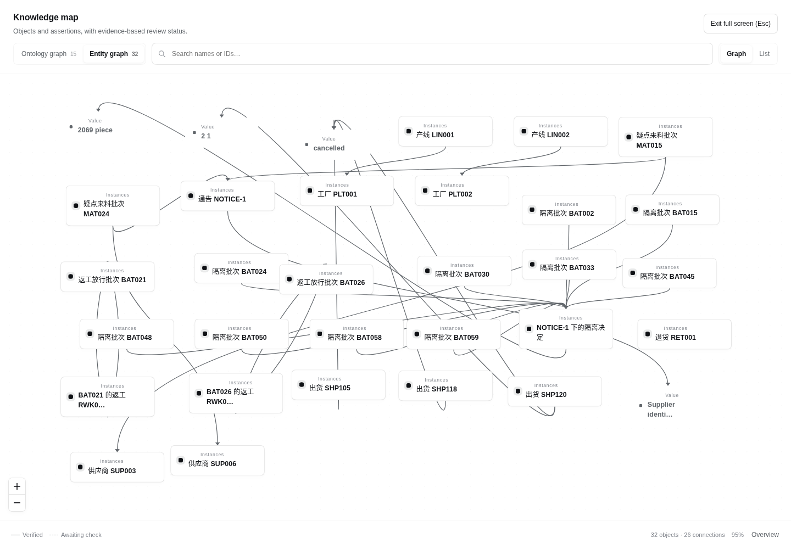
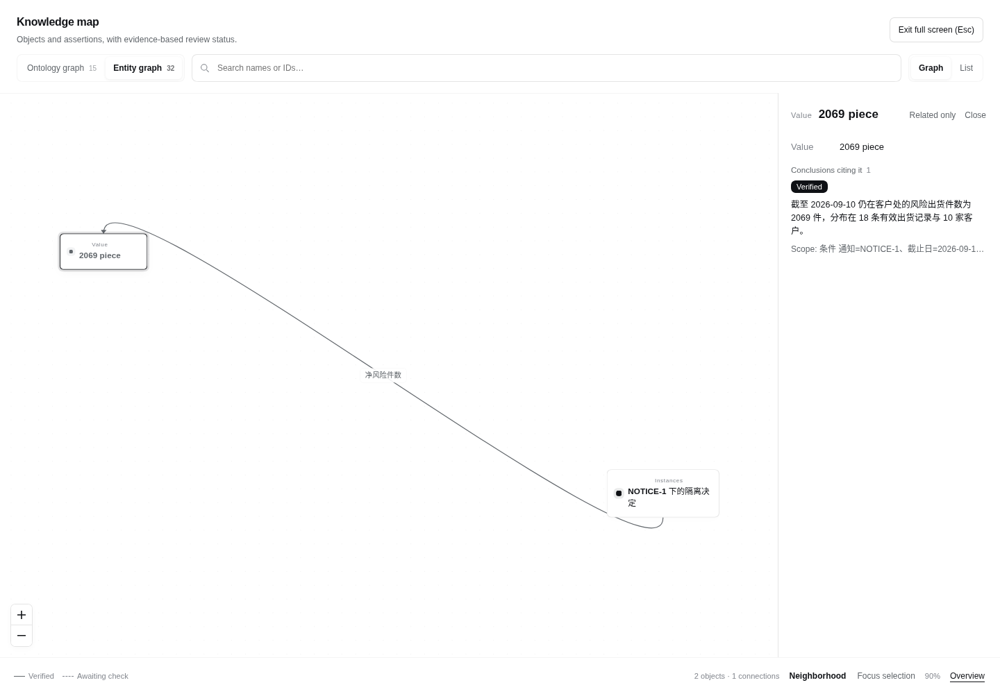
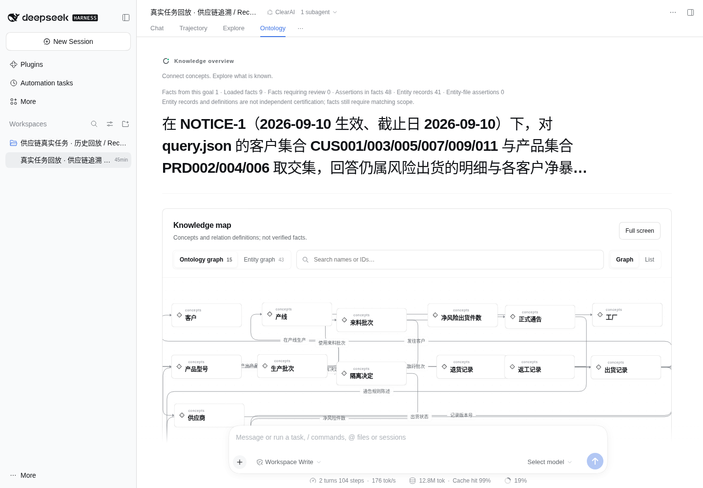
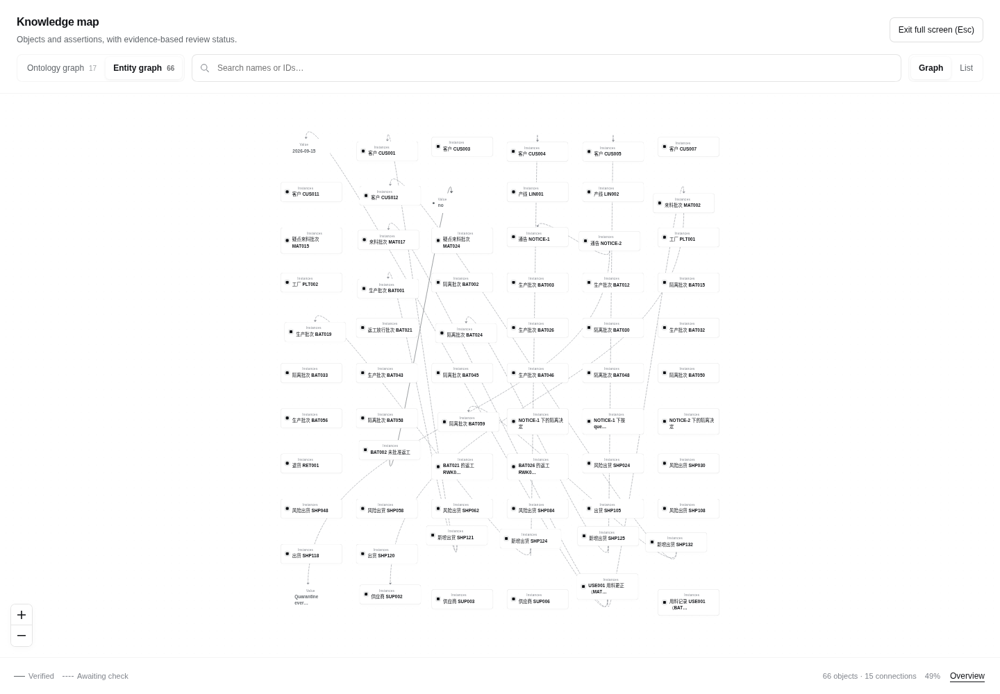

# Supply-chain traceability / 供应链追溯

Status: execution ended; release acceptance failed. Native DSH completed all three stages. ClearAI did not close the changed-source task within the expanded token budget. [Detailed results](../optimization/0.6.0-agent-native/release-case-results.md).

## Task / 任务

A synthetic supplier/lot/production/shipment dataset contains shared trade names, repeated line labels, shipment versions, cancelled shipments, returns and rework. The task is to derive the batches subject to a formal quarantine notice and customer exposure, preserve reusable traceability knowledge, answer a narrower query in a fresh session, then revalidate after a new notice and corrected records.

这不是一次只要求文字答案的测试。两组都需要交付报告、可复跑的分析方法、带源行证据的图，以及机器可读的业务结果。三个阶段保留工作区、重新建立会话：构建 → 复用查询 → 资料变更后重验。

Both groups use official DSH `0.2.2-rc.1` and `deepseek-flash / medium`. Native DSH has its normal tools and can save scripts and notes. ClearAI adds the ontology and independent-review contract. The source world and prompts are frozen; each group is isolated from the controller, the other group and previous runs. [Preregistered protocol](../optimization/0.6.0-agent-native/release-case-protocol.md).

## What counts as an effect / 如何判断效果

| Layer | Evidence required | What it does not establish |
| --- | --- | --- |
| Business answer / 业务答案 | Independently recomputed quarantine set, exposure rows and customer totals | Correct totals alone do not validate every explanation |
| Reusable artifacts / 可复用产物 | Scripts reproduce recorded results; later sessions actually use prior artifacts | A declared reuse list alone does not prove reuse or savings |
| Exported graph / 导出图 | Typed entities and relations match source records and cite locatable rows | Exporting a graph is not independent certification |
| Platform ontology / 平台本体 | Persisted concepts, entities and assertions load in the next session | Definitions and source-record assertions are not automatically verified facts |
| Trusted knowledge / 可信知识 | Independent verdict, claim scope, structured assertions and evidence | A fact count is not a coverage or accuracy score |
| Changed materials / 变化处理 | Old reports preserved; new source version and affected claims reviewed | Old support cannot certify a changed conclusion |

The initial source graph has 234 core entities and 508 core relations; the updated source graph has 246 and 532. Internal extras such as notices, returns and review objects are counted separately. Partial platform coverage is reported even if the exported graph is complete.

## Reading the retained knowledge / 如何阅读沉淀结果

The first stage retains 13 concepts, 28 entity records and 8 fact files containing 26 assertions. These are selected decision-relevant objects; the complete 234-entity/508-relation source graph is a separate export. Of the 234 core source entities, 23 appear in the platform store at this stage. Four of the 508 core source relations appear in stored fact assertions. The additional quarantine, notice and release relationships are useful domain results, but they do not fill those missing source relationships.

首次构建阶段的“2,069件”不是一个脱离条件的数字：它关联 NOTICE-1、2026-09-10 截止日、18条风险出货和10名有暴露客户。复用查询阶段在新会话读取既有知识文件、代码和报告，回答客户集合与产品集合的交集查询，得到899件；保存的一条新事实包含22条结构化断言。事实包数量小于断言数量，二者都不等于对整个图的认证。

*Real first-stage session replayed in official DSH with the production client. The 32 rendered nodes include 28 entity records and four value nodes; they are not the complete exported graph. [Source and bundle hashes](../shots/0.6.0-supply-chain/phase-1/provenance.json).*

*The claim inspector connects a result to its scope. This is a recorded-session replay, not a new model run or the original live execution.*

*New-session query after recovery. [Second-stage screenshot provenance](../shots/0.6.0-supply-chain/phase-2/provenance.json). Existing source knowledge, new query assertions and historical scopes remain separate.*

本轮已观察到两个不同的效应：缺少结构化断言的结案在派评前被退回；修订后的PRD006例外主张单独核验，其他合格事实保留。也观察到明确代价：传输失败、裁决JSON格式错误导致的重评，以及主代理在查询阶段继续扩展校验代码。复用发生了，不代表已经证明节省了时间或token。

资料变更阶段给出了更具体的反例：当前提交已经算对2,332件，但登记主张仍将CUS006写成155而非150、CUS010写成197而非192；另一条并集主张仍为3,408而非3,398，目标判据也保留了旧暂算值2,342。独立核验拒绝了这个7条主张的组合，并指出USE001更正后出现的物料组件异常。仅1条确认不受这些问题影响的返工事实被保存。主代理修订后选择3条主张重新核验，而没有把已经保存的返工事实重新加入。这是本次观察到的局部修复行为；不等于所有受影响主张都可免于重新核验。

这里修正的是ClearAI自身登记记录与正确提交之间的不一致。原生组的客户分项本来就正确，因此这个例子证明了知识写入前的一致性检查发挥作用，不能作为ClearAI超越原生组答案准确性的证据。它也暴露了重复维护暂算值的代价：目标判据、命题文字、断言和报告越多处保存同一个数，越容易在修正时遗留旧值。

## Result / 最终结果

| Including failed attempts and recovery | Native DSH | ClearAI |
| --- | ---: | ---: |
| Stage time summed / 阶段累计时间 | 20.30 min | 109.91 min |
| Processed tokens, lower bound / 处理token下界 | 11,360,564 | 78,639,149 |
| Output tokens, known / 已知输出token | 170,698 | 946,825 |
| Known-use peak USD estimate / 已知用量估算 | 0.319688 | 2.001066 |
| Estimate plus full unknown reserves / 含未知预留 | 1.119688 | 3.601066 |
| Completed stages / 完成阶段 | 3/3 | 2/3 |
| Current exported core entities / 当前导出核心实体 | 246/246 | 246/246 |
| Current exported core relations / 当前导出核心关系 | 532/532 | 531/532 |

Both groups derive the correct current administrative result: 11 quarantined batches, 22 exposure shipments and 2,332 pieces. Native includes two zero-exposure customers; this is consistent with the request for all customers. ClearAI's exported graph still links BAT001 to MAT017 instead of the corrected MAT002 even though its calculation uses the correction. Script reproduction preserves that mismatch; reproducibility does not prove correctness.

ClearAI ends with 15 concepts, 63 platform entity records and 10 stored fact files / 49 assertions across historical scopes. Of the current source graph, 52/246 core entities and 27/532 core relations occur in this store. Only one new fact was retained in the changed-source session. The complete exchange graph and this selective ontology are different outputs.

资料变更阶段在约60分钟、5000万处理token边界停止。三次支持性目标裁决都重新登记同一个USE001异常，新ID再次拦住结案；主代理处置后又派评。最后一轮未落定，目标保持开放。本例暴露了结案协议问题，也说明不能用正确答案或漂亮图谱代替端到端验收。

*Recorded state after the token stop: 63 entity records plus three value nodes. Dashed assertions are awaiting check. [Final provenance](../shots/0.6.0-supply-chain/phase-3/provenance.json) · [Short official DSH replay video](../shots/0.6.0-supply-chain/phase-3/replay.webm). This is not a successful completed-task screenshot.*

The demonstrated value is inspectable scope, evidence and rejection history, including one independently retained fact from a rejected bundle. Native already produces correct quantities and reusable artifacts, so this case establishes neither an accuracy advantage nor an efficiency advantage. ClearAI's main agent accounts for most known processed tokens; evaluators account for most request time. Both paths need attention.

## Graph-view clarification after remediation / 修复后视图澄清

The original scoring assumes an effective current graph. Subsequent independent review confirmed that a graph explicitly representing raw `material_usage` records correctly retains BAT001→MAT017. Calling that edge simply wrong was too broad. It does not supply the corrected current relationship by itself. Source and effective views should be named separately, with the cutoff and correction citations. The original 531/532 current-view score is preserved; it is not an accuracy score for the raw-source view. See [the dual-view remediation](supply-chain-remediation/README.md).

## Interpretation limits / 结论边界

This is one synthetic case executed by real models, not external supply-chain validation or a statistical benchmark. Native DSH may solve the business problem accurately without the ClearAI knowledge store. A successful ClearAI case must therefore demonstrate the additional evidence and reusable knowledge it retains, while also reporting the additional work and failures.

Processed tokens include cache reads; they are not all newly generated tokens. Costs use the recorded peak price table as conservative estimates, not invoices. Per-role request durations can overlap and must not be added as task wall time. Later-session use is observational evidence of reuse; without a cold ablation it does not quantify savings caused by stored knowledge.

所有传输失败、未通过核验和恢复尝试均保留。截图来自本轮真实会话在官方 DSH 中的历史回放，使用生产构建；不把回放截图称为原运行现场，也不以截图证明实时延迟。
